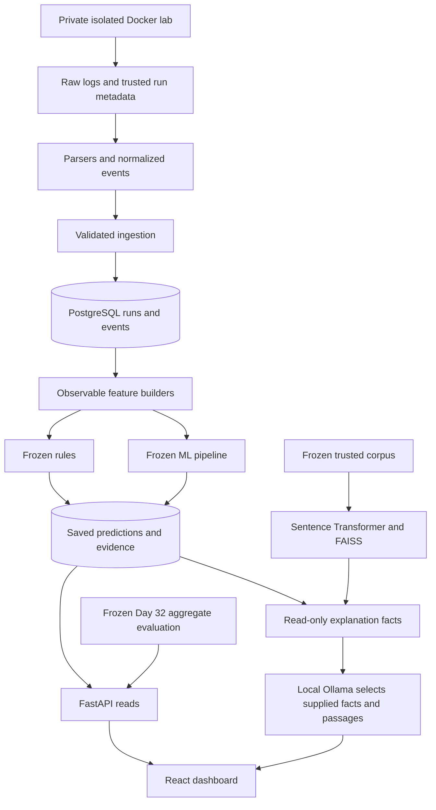

# System architecture and data flow

The platform supports learning from controlled authentication, web and network observations. It preserves collection labels, compares transparent rules with a frozen Logistic Regression model, and displays the supporting evidence.

The training branch uses curated lab observations to build dataset v1, perform run-disjoint development splits, select a model, and freeze its pipeline. The separately reserved final collection supplies the Day 32 held-out evaluation. Online detection reuses the frozen feature and inference code and stores results before explanation.

| Component | Responsibility |
| --- | --- |
| Private lab | Produce bounded scenario runs and benign comparisons. Preserve original logs and trusted metadata outside the public repository. |
| Normalization | Parse timestamped SSH events, structured HTTP requests and accepted TCP connections. Join the trusted run identity and labels. |
| Feature builders | Aggregate authentication and network events by fixed 60-second run/source/target windows; aggregate web requests by run. |
| Rules and ML | Independently produce predictions from observable features. Preserve detector version, evidence and source references. |
| PostgreSQL | Store runs, normalized events and detector records. Foreign keys maintain run/event linkage. |
| FastAPI | Validate ingestion, process a stored run, expose evidence and frozen evaluation, and serve optional local explanations. |
| React/TypeScript | Display recent activity, separate rule/ML outputs, trusted expected labels, evidence, metrics and citations. Types are generated from OpenAPI. |
| Local RAG | Retrieve relevant approved scenario passages from FAISS. Gemma selects supplied fact and passage IDs; the server renders approved text and returns references. |

Ground truth comes from the controlled collection protocol. It stays in run metadata, distinct from predictions. Explanation reads saved results and has no database write or detector-update path. Explanation responses return to the client without a dedicated persistence table.

The local demo supports one user. PostgreSQL is the standard database, with a disposable SQLite fallback. The dashboard lists up to 20 recent events and predictions. The [technical guide](final-technical-guide.md) records setup, API and version details, and the [lab reference](final-lab-reference.md) defines the evidence boundaries.
