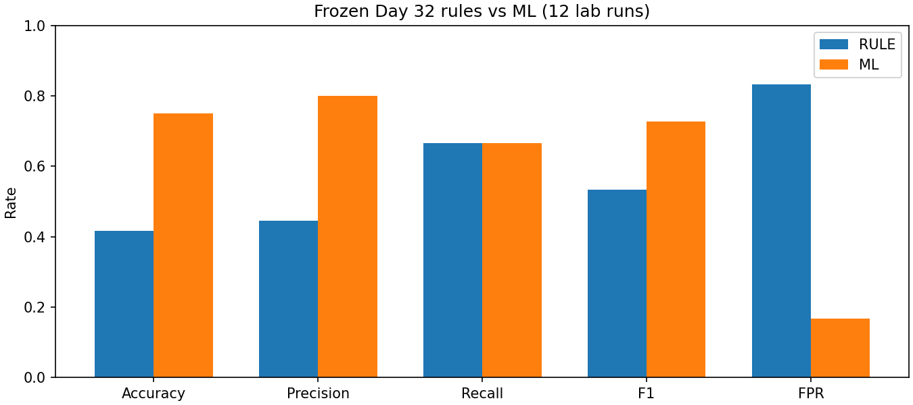
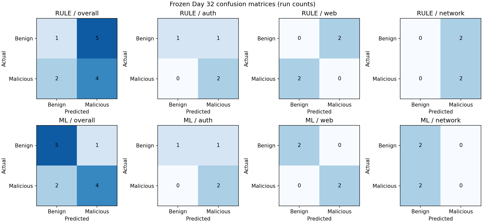

# Day 56 frozen evaluation package

The package starts at the verified `integrated-system` milestone. It presents the frozen Day 32 reserved evaluation, using the same twelve lab runs and the same rules and Logistic Regression model. The [CSV](../data/processed/day56/metrics.csv), [tables](../data/processed/day56/tables.md), and [provenance](../data/processed/day56/provenance.json) record overall and scenario metrics, sample counts, confusion matrix cells, dataset identity, model bytes and evaluation hash.

## Error interpretation

Authentication has one false positive per detector among two benign runs, and both detect the two malicious runs. The historical review identifies different benign retry runs as the false alerts. A shared summary score therefore does not imply identical decisions.

The web rule falsely flags both benign runs and misses both malicious runs. Its token heuristic can match benign wording and miss attack syntax. ML classifies all four held-out web runs correctly. That small result does not establish universal SQL injection detection. The later Day 52 benign phrase still produces a false alert from both detectors and remains a separate documented regression case.

For reconnaissance, the rule flags both benign runs as well as both malicious runs. ML flags none, missing both malicious runs. The accepted-connection features have limited visibility, and legitimate multi-service activity can resemble discovery. A low false positive rate alone can conceal a detector that fails to detect malicious activity.

Overall, rules have five false positives and two false negatives. ML has one false positive and two false negatives. Rules and ML each detect four of six malicious runs, with different scenario-level misses. The corpus is small, balanced and scripted. Generalization, production traffic and attack success remain outside these results.

## Cross-check and reproduction

Run `python scripts/package_day56_evaluation.py --check` to reproduce the tables and provenance. To regenerate the figures, install `matplotlib==3.10.8` and run the command without `--check`. The tool only reads frozen aggregate files. Dataset provenance distinguishes the development dataset hash from the twelve-run reserved evaluation population. The model metadata's `final_test_evaluated=false` reflects its Day 31 freeze, before Day 32 evaluation.

Chromium compares every displayed rate and every confusion matrix cell across all four scopes against the same frozen report returned by FastAPI. Existing CI continues the attack smoke tests, benign comparisons, PostgreSQL persistence, RAG retrieval and explanation tests. Ground truth and predictions retain their distinct API fields. The LLM contributes explanation text only.
