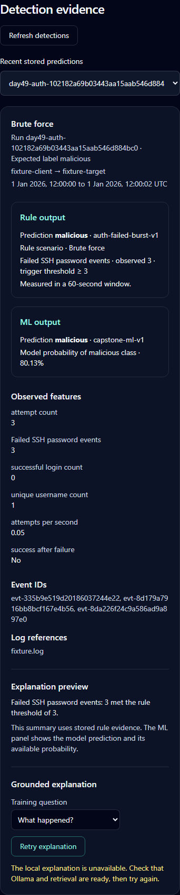

# Day 60 evidence index

This directory assembles public-safe documentation evidence. Original captures remain in the private archive.

| File | Purpose and identity |
| --- | --- |
| [rc1-manifest.json](rc1-manifest.json) | Preserves the verified RC1 source commit, archive hash and frozen-artifact hashes. |
| [private-capture-references.json](private-capture-references.json) | Lists the private Days 49, 50, 51, 54 and 59 capture run IDs, trusted labels and original file hashes. It contains no log bodies. |
| [fallback-evidence.png](fallback-evidence.png) | Existing Day 55 synthetic screenshot, visually reviewed with its matching run and event IDs. It demonstrates the available detector evidence when local explanation returns 503. |
| [fallback-trace.json](fallback-trace.json) | Links that screenshot to synthetic run `day49-auth-102182a69b03443aa15aab546d884bc0`, three event IDs, observed count, threshold and separate predictions. |
| [checksums.json](checksums.json) | SHA-256 values for the four evidence files above. Text uses UTF-8 and LF line endings. |

The screenshot is a historical synthetic fallback example. The private acceptance records below document real isolated-lab observations and live local RAG validation. They have separate run identities.

| Scenario or milestone | Run ID | Verification record |
| --- | --- | --- |
| Brute force | `day49-auth-bruteforce-20261117T071818Z` | [Day 49](../../day49-brute-force-trace.md) |
| SQL injection | `day50-sqli-20261117` | [Day 50](../../day50-sql-injection-trace.md) |
| Reconnaissance | `day51-recon-20261117T081048Z` | [Day 51](../../day51-reconnaissance-trace.md) |
| Clean-lab reproduction | `day54-clean-auth-20261117T130518Z` | [Day 54](../../day54-clean-start.md) |
| RC1 rehearsal | `day59-auth-20261120T123332Z` | [Day 59](../../day59-release-candidate.md) |

The [Day 56 figures and exact tables](../../day56-final-evaluation.md) present frozen evaluation results. The [architecture](../../architecture.md) and [lab topology](../../final-lab-reference.md) provide the diagrams. The [RC1 workflow](https://github.com/MohammedHafidh/ai-cybersecurity-training-platform-public/actions/runs/44818360691) hosts the verified source and synthetic backup artifacts. CI artifacts have retention limits; the committed files here retain the selected screenshot, trace and provenance.
