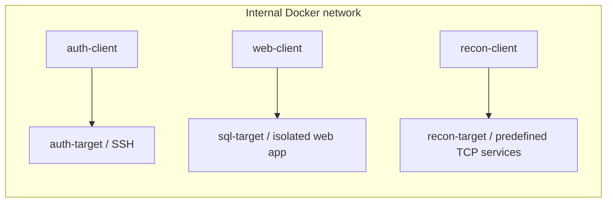

# Private lab and scenario reference

The original private repository retains the Docker lab and raw academic evidence. The active public repository contains the defensive pipeline, synthetic regression fixtures, and safe acceptance records. The sole project owner is responsible for controlled collection and validation.

The approved Compose topology uses an internal bridge network. The live lab target services have no host-published ports. The application demo PostgreSQL service is a separate Compose project bound to loopback. The private lab's scripts fix the target service names and bound each approved variant.

## Collection procedure

Use a dedicated private evidence directory for each collection. Reset only the chosen lab project, rebuild the required services, confirm its internal network and target identity, and record a unique run ID and collection start time. Execute the approved bounded variant. Capture original timestamped target logs and matching metadata, record the end time and hashes, then stop/reset the selected project. On Windows, keep shell-script input as UTF-8 bytes with LF line endings when invoking the existing private script.

| Scenario | Approved procedure and evidence |
| --- | --- |
| Brute force | Use authentication variant 1 against the internal SSH target, with three bounded failed attempts. Preserve timestamped OpenSSH failure logs. Group by run, source IP and target in fixed 60-second windows. The frozen rule flags at three failures. See [Day 49](day49-brute-force-trace.md), [Day 54](day54-clean-start.md) and [RC1](day59-release-candidate.md). |
| SQL injection | Use the private web client's approved variant 1 against the internal SQL training target. Preserve the structured target request log and metadata. Confirm method, path, normalized input and response status against the capture. Aggregate by run. The frozen rule flags at one SQL-like token match. See [Day 50](day50-sql-injection-trace.md). |
| Reconnaissance | Use approved reconnaissance variant 1 against predefined internal ports 8080 and 9090. Preserve scan text/XML and timestamped target connection records. Scan reports establish observed open ports; accepted-connection logs supply feature counts and timestamps. The frozen rule flags at two distinct ports in a fixed 60-second window. See [Day 51](day51-reconnaissance-trace.md). |

Metadata records the run ID, scenario, expected label, source, target, collection window, method and declared log references. Benign collections receive trusted benign metadata. A malicious collection label describes the deliberately generated scenario. Predicted labels are computed later and may disagree with the collection label.

Original files remain immutable in the private archive. If the operational pipeline needs a derived projection, preserve both originals and derivation provenance. The Day 51 record explains the verified association of unassigned target events with the scan window. Do not infer individual connection times or a connection rate from Nmap open-port output alone.

## Safety, scope and reproduction

Operate only within the approved internal Docker lab. Keep live scripts, raw requests, usernames, endpoint addresses and original logs in the private archive. The public [evidence index](evidence/day60/README.md) carries hashes, run references and aggregates. The public [demo runbook](day53-demo-rehearsal.md) offers synthetic raw-log replay for reproducible application demonstrations and the [fallback guide](day55-integration-fallbacks.md) covers failure recovery.

Authentication retries can cause false alerts. SQL-like token matches can reflect harmless text or miss attack syntax. Instrumented TCP services record accepted connections with limited scan visibility. The frozen evaluation reports these errors; it does not establish production detection performance or successful exploitation.
